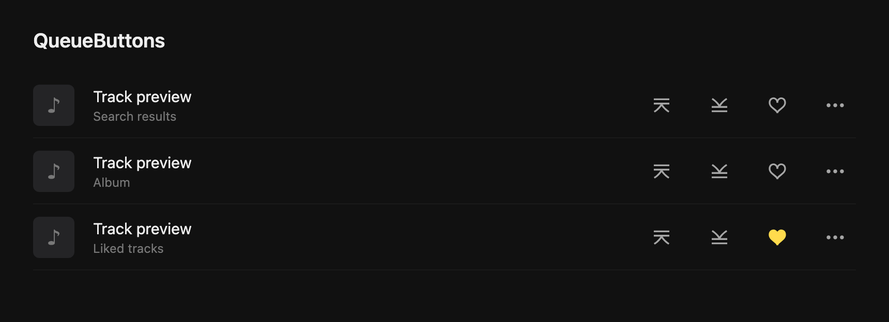

# QueueButtons

Two handy queue buttons for Yandex Music with [PulseSync](https://pulsesync.dev). Pick what plays next, or add a song to the end of your queue, without opening the track menu every time.

- **Play next** puts the song right after the one playing now.
- **Add to end of queue** puts it after everything already queued.

Both buttons sit to the left of the heart in search results, albums, and Liked tracks. Play next stays closest to the heart. They use Yandex Music's own icons and colors, and clicking either one leaves your current song playing.



*A preview of the layout using the client's native icons.*

## Install

1. Get [QueueButtons-1.1.0.pext](dist/QueueButtons-1.1.0.pext).
2. Open PulseSync and drag the file into its window.
3. Find **QueueButtons** in the addons library and enable it. Yandex Music may reload.

If dragging does nothing on macOS, run this from the project folder:

```sh
open -a PulseSync dist/QueueButtons-1.1.0.pext
```

Already using **PlayNextInline**? Import this file over it. QueueButtons is the same addon under a new name, so it updates your existing installation.

Keep PulseSync running alongside the modified Yandex Music client. To remove the buttons, disable QueueButtons in the addons library.

## Using the buttons

Hover over either icon to see what it does. You can also reach the buttons with Tab and press Enter or Space.

Adding several songs to the end keeps the order you picked them in. With Play next, the most recently picked song goes next, just like Yandex Music's track menu. Unavailable tracks have disabled buttons.

## Development

The addon lives in `addon/`: plain JavaScript, CSS, and metadata. There are no runtime dependencies or calls to outside services.

```sh
npm ci
npx playwright install chromium --only-shell
npm run check
npm test
npm run build
```

The build writes an importable `.pext` file to `dist/`. Browser tests cover both queue actions, button placement, keyboard controls, loading more tracks, and upgrading from PlayNextInline. They use a simulated queue; check both actions in the desktop client before publishing.

[Publishing guide](docs/publishing.md) · [Release notes](docs/release-notes-1.1.0.md) · [Original addon search](docs/existing-addons.md)
