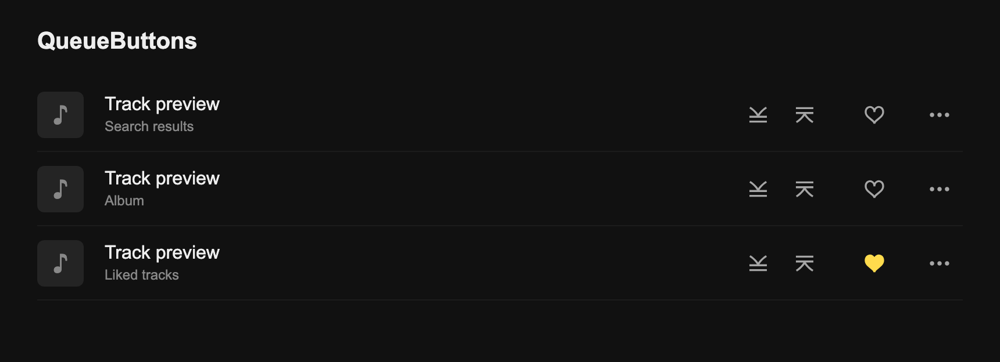
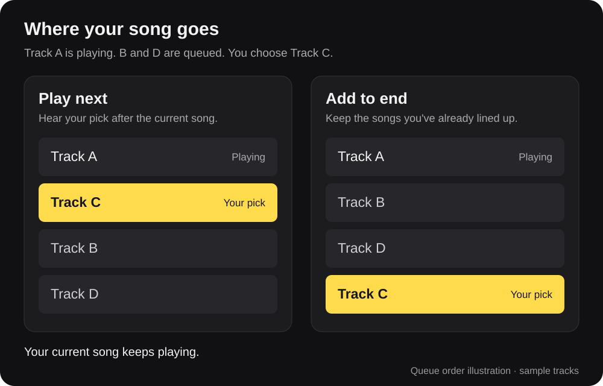

# QueueButtons

Queue songs as you browse, without opening the track menu every time.

[GitHub — source code](https://github.com/WALHAY/pulsesync-queue-buttons) · [Downloads](https://github.com/WALHAY/pulsesync-queue-buttons/releases) · [Report an issue](https://github.com/WALHAY/pulsesync-queue-buttons/issues)

QueueButtons adds two small buttons beside the heart in Yandex Music's search results, albums, and Liked tracks. They use the client's own icons and colors, and your current song keeps playing when you click them.

_Layout illustration with sample tracks._

## Choose what plays next

- **Play next** puts the song right after the one you're listening to.
- **Add to end** puts it after the tracks already in your queue.

From left to right, the buttons are **Play next → Add to end → Like**.

Use **Add to end** when you're picking several songs and want to keep them in that order. With **Play next**, your most recent pick goes first.

_Queue order illustration. This explains the actions; it is not a screenshot of the queue panel._

In **My Vibe**, Add to end places songs after your manual queue and before the next recommendations. It follows Yandex Music's built-in queue behavior.

## Getting started

Enable **QueueButtons** in PulseSync, then open a track list in the modified Yandex Music client. Keep PulseSync running while you listen.

Hover over either button to see its label. Labels follow the client's language, in English or Russian. You can also use Tab to focus a button and Enter or Space to press it.

Unavailable tracks have disabled buttons. If a song doesn't get added, try the usual track menu. To hide the extra buttons, disable QueueButtons in PulseSync.

For a manual install, import the `.pext` file into PulseSync and enable the addon. See the [installation instructions](https://github.com/WALHAY/pulsesync-queue-buttons#install) if you need help building or importing it.

If you used **PlayNextInline**, importing QueueButtons updates your existing installation.

[Changelog](https://github.com/WALHAY/pulsesync-queue-buttons/blob/main/CHANGELOG.md) · [MIT license](https://github.com/WALHAY/pulsesync-queue-buttons/blob/main/LICENSE)
